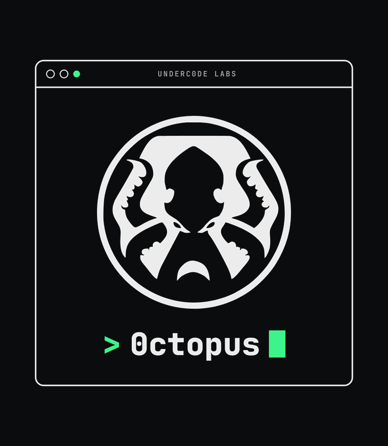

# 📚 Documentación de 0ctopus

**0ctopus** es la navaja suiza de seguridad de **Underc0de**: una CLI de pentesting en Python, un motor de **reportes HTML** con el estilo de Underc0de y una **capa agéntica** (300+ agentes + skills) para orquestar evaluaciones completas con Claude.

> ⚠️ **Uso autorizado únicamente.** 0ctopus es una herramienta de seguridad ofensiva. Usala solo contra objetivos propios o con permiso explícito. Ver [security.md](security.md).

## Índice

| Documento | Contenido |
|-----------|-----------|
| [installation.md](installation.md) | Requisitos e instalación (Linux/macOS/Windows) |
| [usage.md](usage.md) | Uso de la CLI y del menú interactivo |
| [tools.md](tools.md) | Referencia de todas las herramientas |
| [reporting.md](reporting.md) | Reportes HTML y dashboard |
| [agents.md](agents.md) | Capa agéntica: orquestador, subagentes y skills |
| [architecture.md](architecture.md) | Arquitectura del proyecto |
| [security.md](security.md) | Política de uso responsable y alcance |
| [faq.md](faq.md) | Preguntas frecuentes |

## Formatos

- 🌐 **Web**: abrí [`index.html`](index.html) para el portal de documentación.
- 📄 **PDF**: [`0ctopus-cheatsheet.pdf`](0ctopus-cheatsheet.pdf) — manual/cheatsheet imprimible.
- 🖼️ **Imágenes**: `assets/` (banner SVG/PNG, logo, diagrama de arquitectura).

## Enlaces

- Repositorio: https://github.com/underc0delabs/0ctopus
- Comunidad: https://underc0de.org
