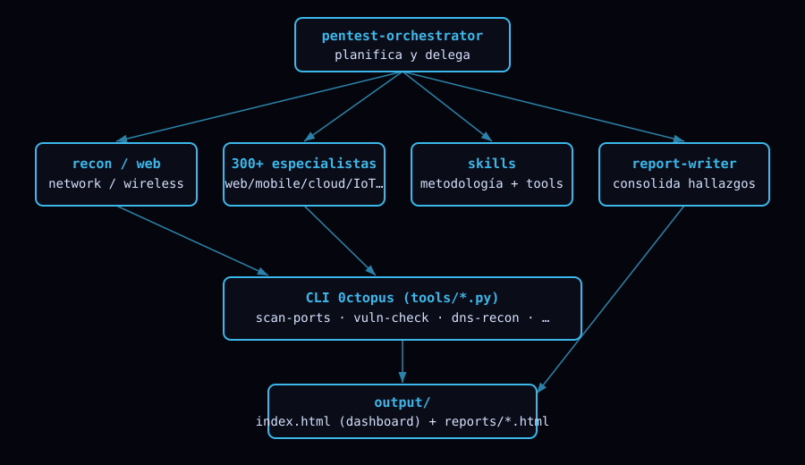

# Capa agéntica

0ctopus incluye una capa de **agentes y skills** para Claude Code (`.claude/`) que permite orquestar evaluaciones completas con lenguaje natural.

## Roles

- **Orquestador** — `pentest-orchestrator`: planifica la evaluación, confirma alcance/autorización y delega en los especialistas; al final invoca al redactor.
- **Especialistas base** (usan la CLI de 0ctopus): `recon-specialist`, `web-specialist`, `network-specialist`, `wireless-specialist`.
- **300+ especialistas avanzados** por dominio (ver catálogo completo en [`../.claude/agents/README.md`](../.claude/agents/README.md)).
- **Redactor** — `report-writer`: consolida los hallazgos en reportes HTML dentro de `output/`.

## Dominios cubiertos

Web/API · Autenticación/Identidad · Mobile (Android/iOS/RN/Flutter) · Streaming/Medios (DRM, HLS/DASH, RTMP) · Cloud/Contenedores (AWS/Azure/GCP, K8s, Docker, IaC) · DevSecOps/CI-CD · Red/Infra · Active Directory/Windows/Linux/macOS · Wireless/RF/IoT/Hardware (WiFi, BLE, Zigbee, LoRa, UART/JTAG/SPI) · ICS/SCADA/OT (Modbus, DNP3, BACnet, OPC-UA) · Médico (DICOM/HL7-FHIR) · Automotriz (CAN/OBD-II) · Avionica/Marítimo (ADS-B/AIS) · Blockchain/Web3 · IA/ML/LLM · Bases de datos · Mensajería/Colas · VoIP/Telecom · Periféricos · Vigilancia/CCTV · Gaming/VR · Wearables/Smart Home · Fintech/POS · Forense/DFIR · Threat Intel/OSINT · Red Team · Compliance/Gobierno · Cripto · Secure Code/SAST.

## Skills

En `.claude/skills/` hay skills de dominio (metodología + uso de tools): `recon`, `web-audit`, `network-scan`, `wifi-audit`, `mobile-audit`, `cloud-audit`, `streaming-audit`, `reporting`, y una skill por cada familia avanzada (iot-hardware, ics-ot, automotive-security, blockchain-web3, ai-llm-security, forensics-dfir, red-team, compliance-governance, etc.).

## Uso típico

> *"Auditá la seguridad de underc0de.org"*

El orquestador: (1) confirma alcance → (2) recon → (3) web/red en paralelo → (4) `report-writer` consolida → (5) abrís `output/index.html`.

## Autorización

Todos los agentes trabajan **solo sobre objetivos autorizados**. Las técnicas intrusivas requieren permiso explícito. Ver [security.md](security.md) y `CLAUDE.md`.
